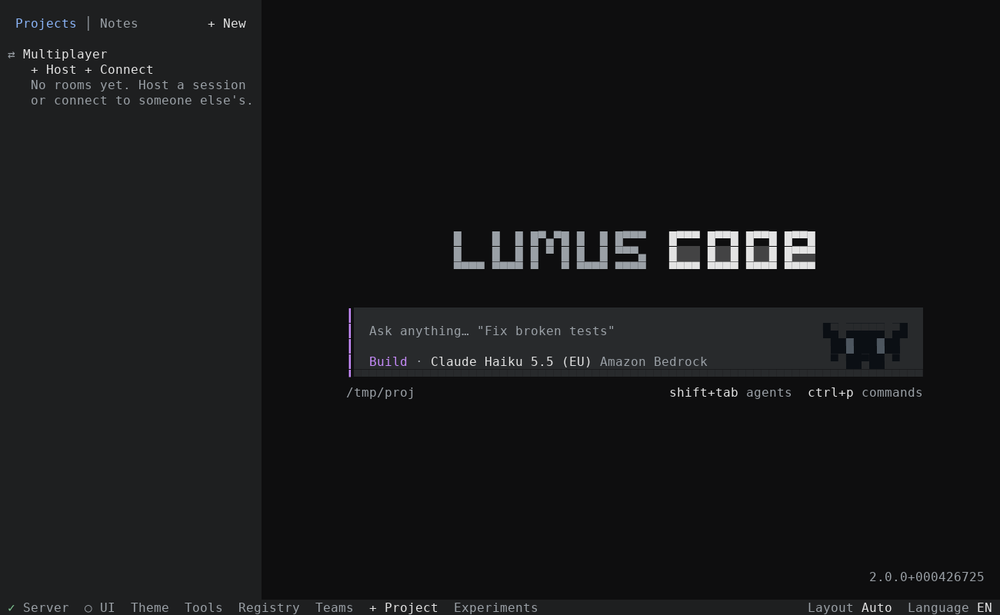

# Lumus Code

An AI coding agent for the terminal, with multiplayer rooms, a project AI team, notes, a Hub of CLI tools, a Gemini-style theme, and an **external-agent mode** that lets an outside agent join a room safely.

> **Provenance.** Lumus Code is based on [OpenCode](https://github.com/anomalyco/opencode) and [NeiP4n/opencode-plus-plus](https://github.com/NeiP4n/opencode-plus-plus), both MIT licensed. The original LICENSE and copyright notice are kept in [LICENSE](LICENSE). **Lumus Code is not built by or affiliated with the OpenCode team.** Internal package names still say `opencode` in many places so the code stays easy to merge with upstream.



## What is included

From opencode-plus-plus (all kept):

- **Multiplayer rooms**: a Host shares a session or a whole project, others Connect with a code or room ID. Roles: viewer, member, helper, cohost.
- **Orchestrator and AI team** for a project.
- **Notes** with their own Notes agent.
- **Hub** of CLI tools the AI can use.
- **Nushell** as the shell for AI commands.
- **DoD task board** (`.opencode/dod.yaml`) and file sections that room members take and hand over.
- **English / Russian** interface.
- A one-command installer.

New in Lumus Code:

- **Gemini-style theme** (`gemini`, dark and light: blue, purple and pink accents on soft grey surfaces). It is the default; every older theme is still selectable.
- **External-agent mode** (below).
- Lumus Code branding and installer.

## Install

| System | Command |
| --- | --- |
| Linux / macOS | `curl -fsSL https://raw.githubusercontent.com/Lumus-ai/lumus-code/main/lumus-code-install.sh \| sh` |
| Windows (PowerShell) | `irm https://raw.githubusercontent.com/Lumus-ai/lumus-code/main/lumus-code-install.ps1 \| iex` |

Then run `lumus-code`. A regular `opencode` on the same computer keeps its own command. The installers were adapted from the fork's and have not been run end to end on a clean machine for this release.

## External-agent mode

An outside agent (for example an Instinct assistant) can join a room, post answers and tool results, and ask for file edits or commands, without ever calling the Host's model.

1. The Host shares a room as usual and gives out the code (the server needs a password for rooms that other computers join).
2. The agent joins with `external: true`:
   ```
   POST /api/room/join
   {"code": "ABCD-EFGH", "name": "Instinct", "external": true}
   ```
   The server stores the name as `Instinct (external)` and gives the guest at most the **member** role, whatever the room's default role is.
3. The guest token works on **one write route** and the usual read routes:
   ```
   POST /api/room/:roomID/guest/external   (Authorization: Bearer <token>)
   {"kind": "answer",      "text": "..."}
   {"kind": "tool_result", "tool": "grep", "text": "..."}
   {"kind": "prompt",     "text": "ask the Host model to do this"}   (the Host approves the full text first; then it runs as a prompt from the external author)
   {"kind": "command",     "command": "npm test", "text": "why I want this"}
   {"kind": "edit",        "path": "src/a.ts", "content": "...", "text": "why"}
   ```

In the TUI the Host writes `/instinct <text>` or `@instinct <text>` to talk to the external agent without running the Host model. A small stdlib-only Python client is in `script/lumus-guest.py` (`join`, `read`, `answer`, `result`, `command`, `edit`). It was tested against a local server for join, answer, tool_result and read; command waits for the Host as designed.

Rules the server enforces:

- `answer` and `tool_result` are **message-only**: they are queued in the session as messages from the external author and shown in the room chat as `<name> (external)`. The Host's model is not started by them. Note that the text sits in the session's inbox and the Host model will see it as context the next time it runs, so treat it as untrusted input.
- `prompt` always waits for the Host's permission prompt (`room.prompt`) showing the text; denied means nothing is queued. Replies of the Host model are readable through `GET /api/room/:roomID/guest/message` (assistant text only, not tool outputs).
- `command` and `edit` always wait for the **Host's permission prompt** (`room.run` / `room.edit`). The external guest cannot answer permission requests itself.
- There is no unrestricted shell: nothing runs without a Host decision per command.
- Edits must be a relative path inside the shared project (symlinks resolved, `.git` refused), at most 200,000 bytes.
- Prompts, runs, DoD actions, model/agent switches and the rest of the guest routes refuse an external guest with 403.
- The author is stamped from the token by the server, so an agent cannot speak as someone else.

## Development

```
bun install
bun run --cwd packages/cli src/index.ts      # start the TUI from source
cd packages/server && bun test test/room.test.ts
cd packages/core && bun test test/external.test.ts
cd packages/tui && bun test test/theme-gemini.test.ts
```

Do not run the full monorepo typecheck on a small machine: it needs well over 2 GB of memory.

## License

MIT. Copyright (c) 2025 opencode, and the contributors of opencode-plus-plus and Lumus Code. See [LICENSE](LICENSE).

## xKiro provider (built in)

[xKiro](https://xkiro.com) is an OpenAI-compatible gateway with a free tier. Lumus Code ships a built-in connector for it.

1. Open the Connect / providers dialog, choose **xKiro**, and paste your API key there (or set `XKIRO_API_KEY`).
2. Open Switch model. Every model from `GET https://api.xkiro.com/v1/models` is listed with its tier in the name,
   for example `Qwen3 Coder Plus (Free) [free]`, `[paid]` or `[premium]`. Free models are listed first.
3. Pick one. Context limit, output limit, tool and image support, reasoning levels and prices come from the gateway.

Status: the model-list mapping, the connect methods (key and env) and the provider definition are covered by unit tests
(`packages/core/test/xkiro`, `packages/core/test/plugin/provider-xkiro.test.ts`). The connector has not been run end to end
with a real xKiro key, and the Connect dialog and Switch model were not visually checked. Blocking requests on the gateway
are cut at 95 seconds, so use streaming (the default in the TUI). Lumus Code is not affiliated with xKiro.
